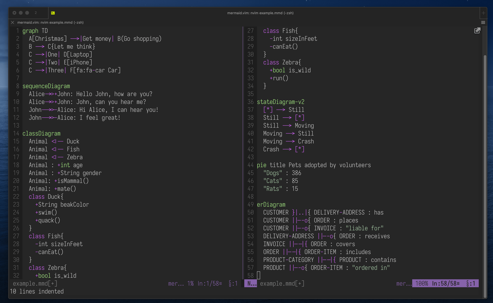

# mermaid.vim

A vim/neovim plugin providing syntax highlighting, indentation and filetype
support for [mermaid](https://mermaid.js.org/) files (`*.mmd`, `*.mermaid`,
`*.mm`).


using [eva01](https://github.com/hachy/eva01.vim) colorscheme

## Installation

### lazy.nvim

```lua
{ 'mracos/mermaid.vim', ft = 'mermaid' }
```

## What it covers

- Every diagram type mermaid currently detects, taken from the detector
  regexes in its source rather than its docs site: flowchart, sequence, class,
  state, ER, gantt, pie, journey, gitGraph, requirement, quadrant, mindmap,
  timeline, kanban, C4, sankey, xychart, block, packet, treemap, treeView,
  radar, architecture, eventmodeling, ishikawa, venn, wardley, cynefin,
  swimlane, usecase, agentflow and railroad. Types that dropped their `-beta`
  suffix are recognised with and without it
- YAML front matter and `%%{init: ...}%%` directives
- Node shapes and link labels, sequence and class operators, ER cardinality,
  gantt dates and task tags, gitGraph attributes
- Indentation for blocks, with `else`/`and`/`option` kept at the level of the
  branch they belong to, and blank lines no longer resetting the level
- Diagrams whose indentation is the diagram itself (`mindmap`, `ishikawa`,
  `treemap`, `treeView`) or where reflowing buys nothing (`sankey`, `packet`,
  `timeline`) are left untouched by `=`

See `:help mermaid` for the details, including `g:mermaid_detect_mm` for the
`*.mm` extension, which vim otherwise maps to objcpp/nroff.

## Tests

No dependencies; the suite runs headlessly against both editors.

```sh
./test/run.sh                    # vim
EDITOR_BIN=nvim ./test/run.sh    # neovim
./test/run.sh indent_spec.vim    # a single spec
```

## Contributing

Please do! Just send a Pull Request and I'll try to see it in due time. :smile:

## License

MIT, see [LICENSE](./LICENSE) for more details.
